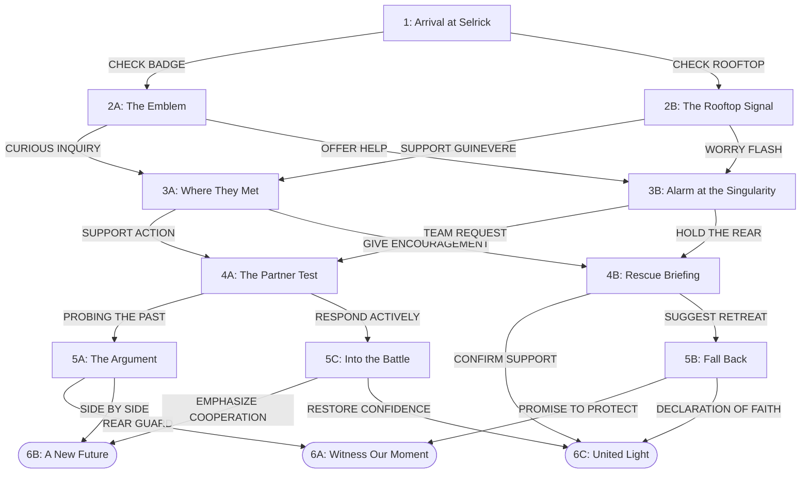

# Interactive drama: the decision tree

Made from the 21 official videos of "Become The Aspirants | Interactive Drama" (Mobile Legends: Bang Bang). Written by `scripts/vexana/drama.py`, from `drama-graph.ts` (the story, written by hand) and `drama.generated.ts` (the numbers).

## What was found

- The official tree has 21 episodes. They are **13 different films**: eight of them are the same film posted under two or three ids. The picture and the sound are the same (the pictures were compared once a second and the sound by correlation: it matches to within the encoder's noise). Only the thumbnail differs, because it shows the answer the viewer chose to get there.
- So each film is one episode here, and the answer that leads to it is kept on the choice (its tag, its text and its card).
- A film ends on a held picture with no choice in it. The game draws the two choices over that picture.
- Six chapters. Chapter 6 is three ending films, reached by seven of the official ids.
- The video is 142 MB in all (1080p).

## The tree

Rounded boxes are endings.

## The same tree as text

- **1** Arrival at Selrick
  - _[CHECK BADGE] This doesn't look like standard Academy gear?_ → **2A** The Emblem
    - _[CURIOUS INQUIRY] This badge... it's an important token, isn't it?_ → **3A** Where They Met
      - _[SUPPORT ACTION] Perhaps I can partner with you?_ → **4A** The Partner Test
        - _[PROBING THE PAST] Vexana... what happened?_ → **5A** The Argument
          - _[REAR GUARD] Go find her! I'll cover you from behind._ → **6A** Witness Our Moment **(ending)**
          - _[SIDE BY SIDE] True partners stick together. I'm with you!_ → **6B** A New Future **(ending)**
        - _[RESPOND ACTIVELY] Stop trying to handle everything yourself. Let me help._ → **5C** Into the Battle
          - _[EMPHASIZE COOPERATION] That's what partners do: we protect each other!_ → **6B** A New Future **(ending)**
          - _[RESTORE CONFIDENCE] Of course, Aces never miss their mark!_ → **6C** United Light **(ending)**
      - _[GIVE ENCOURAGEMENT] You will definitely find her!_ → **4B** Rescue Briefing
        - _[CONFIRM SUPPORT] Roger that! Ground support standing by!_ → **6C** United Light **(ending)**
        - _[SUGGEST RETREAT] Too many enemies! Fall back!_ → **5B** Fall Back
          - _[PROMISE TO PROTECT] I'll guard the Academy until you return._ → **6A** Witness Our Moment **(ending)**
          - _[DECLARATION OF FAITH] The Ace Squad won't leave anyone behind!_ → **6C** United Light **(ending)**
    - _[OFFER HELP] Shall I help you maintain it?_ → **3B** Alarm at the Singularity
      - _[TEAM REQUEST] Teaming up is safer than going alone!_ → **4A** The Partner Test (seen above)
      - _[HOLD THE REAR] I'll handle things back here!_ → **4B** Rescue Briefing (seen above)
  - _[CHECK ROOFTOP] There's something happening over there!_ → **2B** The Rooftop Signal
    - _[SUPPORT GUINEVERE] Vexana must be responding to you!_ → **3A** Where They Met (seen above)
    - _[WORRY FLASH] Could it be a trap?_ → **3B** Alarm at the Singularity (seen above)

## Every episode

### Chapter 1: Arrival

| Id  | Official ids | Title              | What happens                                                                                                                                          | Choices                                                                                                                              | Film                           |
| --- | ------------ | ------------------ | ----------------------------------------------------------------------------------------------------------------------------------------------------- | ------------------------------------------------------------------------------------------------------------------------------------ | ------------------------------ |
| 1   | 1            | Arrival at Selrick | A new student arrives at Selrick Academy and hears of its ace duo, Guinevere and Vexana. A strange badge and a signal from the rooftop catch the eye. | [CHECK BADGE] "This doesn't look like standard Academy gear?" → 2A [CHECK ROOFTOP] "There's something happening over there!" → 2B | `1.mp4`, 0:49, 8.1 MB, 8 lines |

### Chapter 2: The Emblem

| Id  | Official ids | Title              | What happens                                                                                                  | Choices                                                                                                                        | Film                            |
| --- | ------------ | ------------------ | ------------------------------------------------------------------------------------------------------------- | ------------------------------------------------------------------------------------------------------------------------------ | ------------------------------- |
| 2A  | 2A           | The Emblem         | Guinevere says the badge is an Emblem of Hope. She and Vexana made it together, as proof of their bond.       | [CURIOUS INQUIRY] "This badge... it's an important token, isn't it?" → 3A [OFFER HELP] "Shall I help you maintain it?" → 3B | `2a.mp4`, 0:50, 8.9 MB, 5 lines |
| 2B  | 2B           | The Rooftop Signal | Angela, Ruby and Guinevere track an unstable energy signal. Ruby fears it is an Ender, and that it is a lure. | [SUPPORT GUINEVERE] "Vexana must be responding to you!" → 3A [WORRY FLASH] "Could it be a trap?" → 3B                       | `2b.mp4`, 0:49, 7.5 MB, 3 lines |

### Chapter 3: The Bond

| Id  | Official ids | Title                    | What happens                                                                                                       | Choices                                                                                                              | Film                             |
| --- | ------------ | ------------------------ | ------------------------------------------------------------------------------------------------------------------ | -------------------------------------------------------------------------------------------------------------------- | -------------------------------- |
| 3A  | 3A1, 3A2     | Where They Met           | Guinevere remembers how she and Vexana became partners. Her emblem still glows, and she is sure Vexana is waiting. | [SUPPORT ACTION] "Perhaps I can partner with you?" → 4A [GIVE ENCOURAGEMENT] "You will definitely find her!" → 4B | `3a.mp4`, 0:41, 11.6 MB, 4 lines |
| 3B  | 3B1, 3B2     | Alarm at the Singularity | Students report a dangerous signal from the Singularity. The emblem flashes, and Guinevere decides to go alone.    | [TEAM REQUEST] "Teaming up is safer than going alone!" → 4A [HOLD THE REAR] "I'll handle things back here!" → 4B  | `3b.mp4`, 0:46, 7.6 MB, 4 lines  |

### Chapter 4: The Test

| Id  | Official ids | Title            | What happens                                                                                                                      | Choices                                                                                                                                 | Film                             |
| --- | ------------ | ---------------- | --------------------------------------------------------------------------------------------------------------------------------- | --------------------------------------------------------------------------------------------------------------------------------------- | -------------------------------- |
| 4A  | 4A1, 4A2     | The Partner Test | Guinevere tests the newcomer as a temporary partner. Layla judges the aim, and Guinevere admits she fears losing another partner. | [PROBING THE PAST] "Vexana... what happened?" → 5A [RESPOND ACTIVELY] "Stop trying to handle everything yourself. Let me help." → 5C | `4a.mp4`, 0:49, 7.3 MB, 7 lines  |
| 4B  | 4B1, 4B2     | Rescue Briefing  | The Aspirants gather before a map of the Singularity. The Enders are mobilizing, and the team is ready to bring Vexana back.      | [CONFIRM SUPPORT] "Roger that! Ground support standing by!" → 6C [SUGGEST RETREAT] "Too many enemies! Fall back!" → 5B               | `4b.mp4`, 0:52, 14.2 MB, 4 lines |

### Chapter 5: The Storm

| Id  | Official ids | Title           | What happens                                                                                                                                              | Choices                                                                                                                                              | Film                             |
| --- | ------------ | --------------- | --------------------------------------------------------------------------------------------------------------------------------------------------------- | ---------------------------------------------------------------------------------------------------------------------------------------------------- | -------------------------------- |
| 5A  | 5A           | The Argument    | Guinevere admits she and Vexana quarreled the day Vexana vanished. Vexana had seen a doomed future, and Guinevere now sees she only meant to protect her. | [REAR GUARD] "Go find her! I'll cover you from behind." → 6A [SIDE BY SIDE] "True partners stick together. I'm with you!" → 6B                    | `5a.mp4`, 1:08, 11.6 MB, 6 lines |
| 5B  | 5B           | Fall Back       | The newcomer calls a retreat. Guinevere puts everything on the line and entrusts the academy to the newcomer.                                             | [PROMISE TO PROTECT] "I'll guard the Academy until you return." → 6A [DECLARATION OF FAITH] "The Ace Squad won't leave anyone behind!" → 6C       | `5b.mp4`, 0:42, 8.9 MB, 3 lines  |
| 5C  | 5C           | Into the Battle | Guinevere warns that this is real battle. An Ender strikes, and Vexana and Guinevere each try to shield the other.                                        | [EMPHASIZE COOPERATION] "That's what partners do: we protect each other!" → 6B [RESTORE CONFIDENCE] "Of course, Aces never miss their mark!" → 6C | `5c.mp4`, 0:31, 9.0 MB, 4 lines  |

### Chapter 6: The Singularity

| Id  | Official ids  | Title              | What happens                                                                                                                                           | Choices                    | Film                             |
| --- | ------------- | ------------------ | ------------------------------------------------------------------------------------------------------------------------------------------------------ | -------------------------- | -------------------------------- |
| 6A  | 6A1, 6A2      | Witness Our Moment | Vexana believes there is no other choice. Guinevere answers that the choice is theirs together, and the two strike as partners.                        | Ending: Witness Our Moment | `6a.mp4`, 0:39, 11.6 MB, 4 lines |
| 6B  | 6B1, 6B2      | A New Future       | Guinevere will not let Vexana sacrifice herself. Their light destroys the Control Core, the Singularity disappears, and they stand together at sunset. | Ending: A New Future       | `6b.mp4`, 1:05, 16.5 MB, 9 lines |
| 6C  | 6C1, 6C2, 6C3 | United Light       | The whole squad stands behind Guinevere. They say that hope never dies and charge the Singularity together.                                            | Ending: United Light       | `6c.mp4`, 1:04, 18.9 MB, 8 lines |

## Which ids are the same film

| Film | Official ids  | How the ids differ                                |
| ---- | ------------- | ------------------------------------------------- |
| 3A   | 3A1, 3A2      | Reached by: 3A1 from 2A; 3A2 from 2B              |
| 3B   | 3B1, 3B2      | Reached by: 3B1 from 2A; 3B2 from 2B              |
| 4A   | 4A1, 4A2      | Reached by: 4A1 from 3A; 4A2 from 3B              |
| 4B   | 4B1, 4B2      | Reached by: 4B1 from 3A; 4B2 from 3B              |
| 6A   | 6A1, 6A2      | Reached by: 6A1 from 5A; 6A2 from 5B              |
| 6B   | 6B1, 6B2      | Reached by: 6B1 from 5A; 6B2 from 5C              |
| 6C   | 6C1, 6C2, 6C3 | Reached by: 6C1 from 4B; 6C2 from 5B; 6C3 from 5C |
